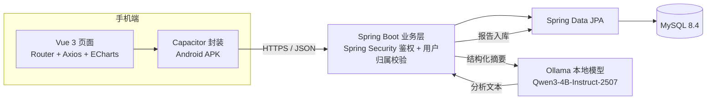

# 健身训练与饮食管理系统（FTDMS）

> 基于 Spring Boot + Vue 3 的健身训练与饮食管理移动应用 · 软件工程课程设计 G13 小组

面向有日常健身与饮食记录需求的个人用户，交付一款运行在 Android 手机上的 App。系统以「日期 + 用户身份」统一关联训练计划、训练记录、饮食摄入与体重数据，解决记录分散、难以回顾"本周练了几次、今天吃了多少、体重怎么变"的问题；并在用户**显式授权**后，由服务端本地部署的开源大模型基于已有数据生成阶段性分析，用户无需重复手动输入。

**项目编号**：G13-FTDMS-2026　|　**周期**：2026-09-28 — 2026-12-30（94 天 / 14 周次）　|　**当前状态**：第一阶段（需求与技术方案冻结，M1）已完成，进入开发阶段

---

## 目录

- [功能范围](#功能范围)
- [技术栈](#技术栈)
- [系统架构](#系统架构)
- [数据库设计](#数据库设计)
- [关键业务规则](#关键业务规则)
- [仓库结构](#仓库结构)
- [文档索引](#文档索引)
- [进度与里程碑](#进度与里程碑)
- [主要风险](#主要风险)
- [团队分工](#团队分工)
- [说明与免责](#说明与免责)

---

## 功能范围

| 模块 | 功能 | 验收要点 |
| --- | --- | --- |
| 账户与目标 | 注册登录、个人资料、每日能量及三大营养素目标 | 登录有效，修改后重新查询结果一致 |
| 训练管理 | 创建日期计划、选择动作、记录每组重量与次数、完成打卡 | 完成/未完成状态明确，历史可查询 |
| 饮食管理 | 搜索食物、按餐次录入克重、汇总能量与营养素 | 增删改后汇总同步更新 |
| 身体数据 | 按日期记录体重，展示区间变化 | 同一用户同日仅一条记录 |
| 统计分析 | 训练完成率、每日摄入、体重趋势 | 可切换时间范围，缺失记录不当作零值 |
| 后台管理 | 动作库、公共食物库维护（含来源标注）、账户状态管理 | 普通用户无法调用管理接口 |
| AI 健身分析 | 授权后自动读取本人指定时段的体重、饮食、训练数据，一键生成分析报告 | 无需重填数据；显示统计口径、有效天数与生成时间；只分析本人；授权可撤回、报告可删除 |
| 移动端 App | 手机屏幕/触控/网络状态适配，Vue 页面经 Capacitor 封装为 Android App | 可安装、可登录，记录与图表流程在手机上可完成 |

**首版不含**：食物图片识别、穿戴设备接入、社交社区、自动处方式推荐；iOS 适配作为条件允许时的后续扩展。移动端交付目标为 **Android 安装包（APK）**。

---

## 技术栈

| 层次 | 技术 | 责任 |
| --- | --- | --- |
| 表现层 | Vue 3、Vue Router、Axios、Capacitor | 手机页面、路由、接口调用与 Android 封装 |
| 图表层 | Apache ECharts | 摄入、训练与体重趋势展示 |
| 业务层 | Spring Boot、Spring Security | 接口、鉴权、参数校验与业务计算 |
| 持久层 | Spring Data JPA、MySQL 8.4 | 数据映射、事务与查询 |
| AI 服务层 | Ollama、Qwen3-4B-Instruct-2507（Apache-2.0） | 服务端本地部署，生成基于事实摘要的文字分析 |
| 移动端构建 | Android SDK、Capacitor CLI | 打包、安装与真机调试 |
| 协作与构建 | Git、GitHub、Maven、Vite | 版本管理、依赖管理与构建 |

本地开发默认端口：后端 `8080`，前端 `5173`。交付期后端与数据库部署于课程演示服务器，手机端通过 HTTPS 调用 JSON 接口，**不直接连接数据库或模型服务**。

---

## 系统架构



分层职责：前端只负责交互与展示；后端统一处理身份校验、业务规则、统计计算与 AI 请求；AI 模型仅接收后端筛选出的必要摘要字段，**不拥有数据库直连权限**。

---

## 数据库设计

建表脚本见 [`backend/test/schema.sql`](backend/test/schema.sql)（MySQL 8.4 / InnoDB / utf8mb4，共 12 张表）。

| 表 | 用途 | 关键约束 |
| --- | --- | --- |
| `user_account` | 用户账户 | `role` 区分普通用户与管理员 |
| `daily_goal` | 每日能量与营养目标 | 按 `effective_date` 保留目标历史 |
| `exercise` | 动作库 | 管理员维护 |
| `food` | 食物库 | 每 100 g 营养值 + 来源 + 生熟状态 |
| `training_plan` | 训练计划 | 一个计划含多个计划动作 |
| `plan_item` | 计划动作 | 目标组数、关联动作库 |
| `workout_log` | 训练记录 | 计划可选，支持临时训练 |
| `workout_set` | 训练组明细 | 重量与次数 |
| `diet_record` | 饮食记录 | **保存录入时的营养快照**，避免食物库变更影响历史 |
| `body_record` | 体重记录 | `(user_id, record_date)` 联合唯一 |
| `ai_consent` / `ai_report` | AI 授权与报告 | 记录授权/撤回、输入摘要、模型版本，支持追溯与删除 |

所有私有记录按 `user_id` 归属，常用日期查询建立联合索引，涉及多表写入的操作使用事务。

---

## 关键业务规则

**饮食换算**
```
单项摄入量 = 每 100 g 对应营养值 × 实际摄入克重 ÷ 100
```
能量统一使用 kcal，蛋白质/碳水/脂肪统一使用 g；先保留计算精度，再按统一位数显示。例：每 100 g 含 120 kcal、蛋白质 8 g 的食物，录入 150 g 后计入 180 kcal、蛋白质 12 g。

**训练完成率**
完成率 = 区间内标记完成的计划数 ÷ 未取消的计划总数；无计划时显示"暂无计划"，临时训练单独计数。修改计划不得覆盖已有训练记录。

**统计口径**
按统一业务时区归属每日记录，支持补录与修改；缺失记录显示为空，**不自动补零**；七日平均按区间内有效日记录计算并同时显示有效天数。

**AI 分析**
默认读取最近 30 天（可切换 7 天），先由后端按确定规则算出训练计划数/完成数、实际训练次数、各日营养摄入与目标差异、体重记录及有效天数，再交给模型解释。资料不足时说明无法判断的项目，不编造结论；模型输出需与原始摘要核对，不一致时不作为确定结论展示。

---

## 仓库结构

```
.
├── backend/
│   ├── test/schema.sql              # 数据库建表脚本（11 张表）
│   └── 技术说明.docx                 # 后端技术说明（待补充）
├── frontend/
│   ├── test/prototype.html          # 手机端线框原型（单文件，浏览器直接打开）
│   └── 技术说明.docx                 # 前端技术说明（待补充）
└── docs/
    ├── 2026-10-9/                   # 初版：项目介绍 1.0、可行性分析 2.0、项目开发计划书
    ├── 2026-10-18/                  # 国标版：FAR、SDP、项目介绍（AI 与移动 App 修订版）、甘特图
    ├── 会议纪要/                     # 10.8 会议纪要
    └── 里程碑w1-w2/                  # 第一阶段需求与技术方案说明书、线框原型、建表脚本
```

> 当前仓库处于第一阶段，内容以**需求、方案与原型**为主，可运行源码将在后续增量中提交。

**快速预览原型**：直接用浏览器打开 `frontend/test/prototype.html`。
**初始化数据库**：`mysql -u <user> -p <dbname> < backend/test/schema.sql`

---

## 文档索引

| 文档 | 说明 | 版本 / 日期 |
| --- | --- | --- |
| [可行性分析（研究）报告 FAR](docs/2026-10-18/健身训练与饮食管理系统_可行性分析报告FAR_国标版.docx) | 依 GB/T 8567—2006 第 7.1 条编制，含技术/经济/法律/用户使用可行性评价，结论为"有条件可行" | V1.0 / 2026-10-18 |
| [软件开发计划 SDP](docs/2026-10-18/健身训练与饮食管理系统_软件开发计划SDP_国标版.docx) | 依 GB/T 8567—2006 第 7.2 条编制，含交付产品、实施途径、进度、估算与风险管理 | V1.1 / 2026-10-16 |
| [项目介绍（AI 与移动 App 修订版）](docs/2026-10-18/健身训练与饮食管理系统_项目介绍_AI与移动App修订版.docx) | 项目背景、功能模块、技术架构、数据设计、AI 分析流程与移动端方案 | 2026-10-18 |
| [项目介绍 PPT](docs/2026-10-18/健身训练与饮食管理系统_项目介绍.pptx) | 汇报用演示文稿 | 2026-10-18 |
| [甘特图](docs/2026-10-18/甘特图-2026-10-18.pdf) | 14 周次进度安排 | 2026-10-18 |
| [第一阶段需求与技术方案说明书](docs/里程碑w1-w2/第一阶段_需求与技术方案说明书.docx) | 需求清单、业务规则、表结构与接口清单基线 | V1.0 / 2026-10-11 |
| [建表脚本](backend/test/schema.sql) | MySQL 8.4 建表 SQL | 随需求基线 |
| [线框原型](frontend/test/prototype.html) | 手机端页面与交互原型 | 随需求基线 |

历史版本见 `docs/2026-10-9/`（项目介绍 1.0、可行性分析报告 2.0、项目开发计划书）。

---

## 进度与里程碑

项目共 14 个周次，采用增量 + 迭代（周为迭代周期）的过程模型：数据层与后端核心（W2–W4）→ 前端页面与图表（W4–W6）→ AI 分析模块（W7–W9）→ 移动端封装（W8–W10）→ 集成测试与验收（W10–W12）→ 结项（W13–W14）。

| 里程碑 | 内容 | 日期 | 状态 |
| --- | --- | --- | --- |
| M1 | 需求与技术方案冻结（范围、表结构、接口清单、技术版本锁定） | 2026-10-11 | ✅ 已完成 |
| M2 | 后端核心接口可联调（账户、目标、训练、饮食、体重，鉴权生效） | 2026-10-25 | ⏳ 进行中 |
| M3 | Web 端全流程可用（计划—记录—统计闭环，图表可切换区间） | 2026-11-08 | 计划中 |
| M4 | AI 分析模块完成（授权/撤回、数据汇总、报告生成与历史） | 2026-11-29 | 计划中 |
| M5 | 最初成品：Android 安装包，主流程可用（**硬性节点**） | 2026-12-02 | 计划中 |
| M6 | 测试验收（功能用例、跨账号隔离、隐私验收、缺陷复测） | 2026-12-20 | 计划中 |
| M7 | 最后交付与结项（程序、文档、答辩材料、归档） | 2026-12-30 | 计划中 |

**开发约定**：接口、表结构或统计口径发生变更时，须在同一 Pull Request 内同步更新对应文档；代码合入需另一名成员 Review 至少 1 个 Approve。

---

## 主要风险

来自 FAR 第 7.3 节的风险登记（按"发生概率 × 影响程度"分级，仅列高等级项）：

| 编号 | 风险 | 对策 |
| --- | --- | --- |
| R1 | 无 GPU，Qwen3-4B 在 CPU 上推理延迟高导致超时 | 限制输入摘要与生成长度、设置超时重试；模型不可用时保留原始统计并提示重试，必要时缩小分析区间 |
| R2 | Capacitor 打包与真机调试受阻（SDK / Gradle / 网络 / HTTPS） | 提前完成最小页面打包与真机安装验证，锁定构建环境版本，预留 1 周缓冲，以 Web 访问作为演示兜底 |
| R3 | 2 人约 280 人时的人力紧张导致进度滑移，影响 12-02 硬节点 | 按周度进度表核对，保持范围守门，必要时裁剪次要功能并说明 |
| R4 | 跨账号数据隔离缺陷（越权访问他人记录或管理接口） | 后端统一 `user_id` 归属校验，管理接口单独鉴权，专项验证与回归复测 |

---

## 团队分工

| 成员 | 职责 | 主要交付物 |
| --- | --- | --- |
| 方文锦 | 需求与项目统筹、后端与数据库 | 需求文档、任务跟踪、集成与汇报；建表、接口、业务规则与权限 |
| 陈智杰 | 前端与交互、测试与文档 | 页面、表单、接口联调与图表；测试用例、缺陷复测、部署与文档 |

---

## 说明与免责

- 本系统定位为**个人记录与管理工具**。食物营养数据采用标注来源的每 100 g 数据，换算结果属于**估算**。
- AI 分析仅提供一般性健身与饮食参考，**不作疾病诊断或治疗建议**；涉及伤病、疾病或特殊饮食需求时请咨询专业人士。报告会明确标注分析区间、统计口径、有效记录天数与生成时间。
- 文档中的口令、密钥一律以占位符表示，真实配置不纳入版本控制；AI 分析仅发送分析所需字段，不传送姓名、手机号等身份信息。
- 本项目为软件工程课程设计作业，不面向社会公众提供服务。
