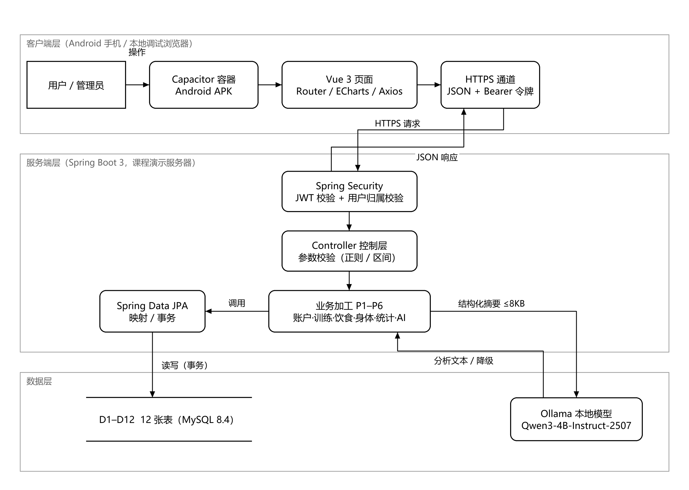
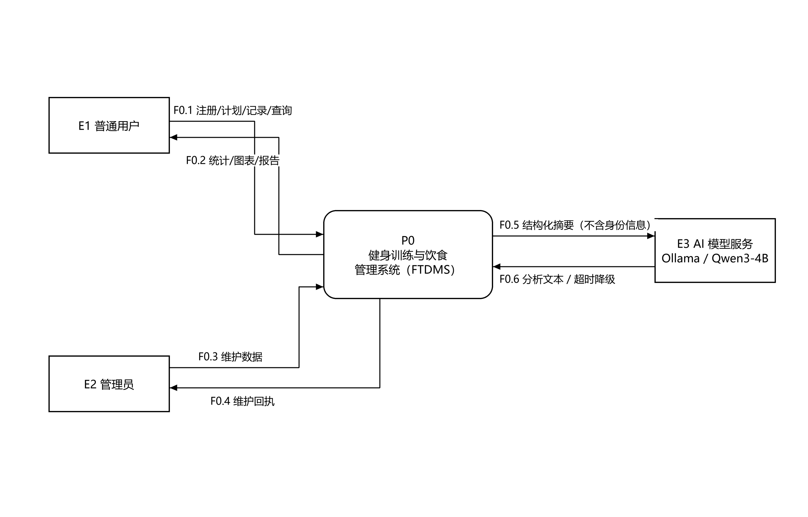
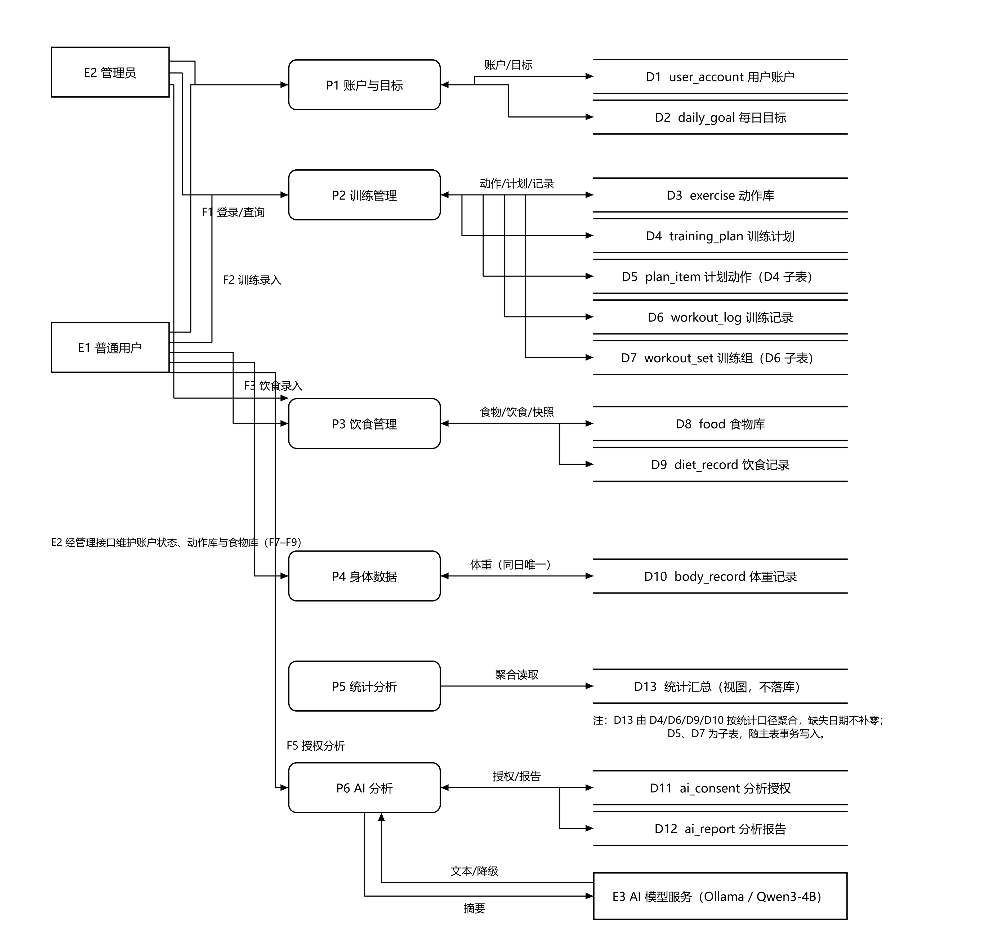
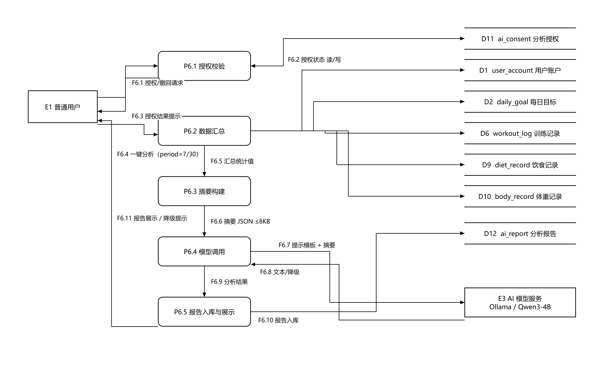

# 附录 A 系统流程图

## A.1 说明

图 A-1 给出 FTDMS 的系统处理流程，按**客户端层 → 服务端层 → 数据层**三层次展开，标注各层组成部件及其间的数据传递。图中实线箭头表示一次请求的走向，末端箭头标注实际承载的数据内容；服务端内部按"鉴权 → 参数校验 → 业务加工 → 持久化"逐级流转，AI 分析作为业务加工 P6 的分支在数据层调用本地模型服务。

图例约定：矩形表示外部参与者，圆角矩形表示处理部件，双横线开口矩形表示数据存储，虚线框表示层次边界。

## A.2 层次组成与职责

| 层次 | 组成部件 | 职责 | 交付形态 |
| --- | --- | --- | --- |
| 客户端层 | 用户 / 管理员、Capacitor 容器、Vue 3 页面（Router / ECharts / Axios）、HTTPS 通道 | 触控交互、页面路由、图表渲染、接口调用与令牌携带 | Android APK（真机安装） |
| 服务端层 | Spring Security（JWT 校验 + 用户归属校验）、Controller（正则与区间校验）、业务加工 P1–P6、Spring Data JPA | 身份认证与越权防护、入参校验、业务规则与统计计算、事务与映射 | 部署于课程演示服务器的服务程序 |
| 数据层 | MySQL 8.4（D1–D12）、Ollama + Qwen3-4B-Instruct-2507 | 结构化数据持久化；本地模型推理，仅接收结构化摘要 | 数据库实例与本地模型服务 |

## A.3 三条关键处理路径

| 路径 | 流转过程 | 关键约束 |
| --- | --- | --- |
| 记录查询 | 用户触控 → Vue 页面组装请求 → 携带 Bearer 令牌经 HTTPS 提交 → Spring Security 解析身份 → Controller 校验参数 → 对应业务加工读取 MySQL → 结果以 JSON 返回 → 页面渲染图表 | 令牌有效期 2 小时；服务端以令牌身份为准，忽略请求中的 userId |
| 训练打卡 | 用户提交实际组数与重量 → 校验通过后在同一事务内写 `workout_log` 与 `workout_set` → 计划状态由 PLANNED 置为 COMPLETED | 计划与实际组数可不一致；修改计划不覆盖已有训练记录 |
| AI 分析 | 校验授权 → 按统计口径汇总数据 → 构建 ≤8 KB 摘要 → 调用本地模型 → 报告入库并回显 | 模型不可用或超时则降级为 DEGRADED，仅保留统计值，不编造结论 |

# 附录 B 数据流图

## B.1 图例与编号规则

| 符号 | 含义 | 编号规则 |
| --- | --- | --- |
| 矩形 | 外部实体（External Entity） | E1、E2、E3 |
| 圆角矩形 | 加工（Process） | 第 0 层 P0；第 1 层 P1–P6；第 2 层 P6.1–P6.5 |
| 双横线开口矩形 | 数据存储（Data Store） | D1–D13，与数据库表 / 视图一一对应 |
| 带箭头实线 | 数据流（Data Flow） | 顶层 F0.x；第 1 层 F1–F18；第 2 层 F6.x |

绘制依据 GB/T 8567—2006 对数据流图的规定，采用自顶向下逐层分解：第 0 层确定系统边界，第 1 层按功能域分解为 6 个加工，第 2 层仅对 AI 分析（P6）继续细化——该加工为本项目区别于普通记录类应用的核心，且涉及外部模型服务与授权合规，需要单独展开。

## B.2 第 0 层数据流图（上下文图）

### B.2.1 外部实体

| 编号 | 名称 | 与系统的关系 | 说明 |
| --- | --- | --- | --- |
| E1 | 普通用户 | 主要数据来源与使用方 | 经手机 App 注册登录，维护本人计划、记录与目标，仅访问本人数据 |
| E2 | 管理员 | 基础数据维护方 | 经后台管理接口维护动作库、公共食物库与账户状态，接口单独鉴权 |
| E3 | AI 模型服务 | 外部推理服务 | 部署于服务端本地（Ollama），接收结构化摘要并返回分析文本，无数据库访问权限 |

### B.2.2 顶层数据流

| 编号 | 名称 | 来源 | 去向 | 主要组成 |
| --- | --- | --- | --- | --- |
| F0.1 | 注册/计划/记录/查询 | E1 | P0 | 账户资料、训练计划与记录、饮食与体重记录、统计查询条件 |
| F0.2 | 统计/图表/报告 | P0 | E1 | 完成率、每日摄入、体重趋势、AI 分析文本、校验提示 |
| F0.3 | 维护数据 | E2 | P0 | 动作库与公共食物库条目、账户状态变更 |
| F0.4 | 维护回执 | P0 | E2 | 写入结果、失败原因 |
| F0.5 | 结构化摘要 | P0 | E3 | 区间、档案、训练统计、营养统计、体重统计（不含身份信息） |
| F0.6 | 分析文本 / 降级信号 | E3 | P0 | 模型生成的五段式分析文本，或超时、不可用标识 |

## B.3 第 1 层数据流图

### B.3.1 加工说明

| 编号 | 名称 | 输入 | 输出 | 处理要点 |
| --- | --- | --- | --- | --- |
| P1 | 账户与目标 | 注册登录信息、资料修改、目标设定（F1）、账户状态（F7） | 令牌与资料、目标查询结果（F6） | 密码加盐散列存储；用户名唯一；目标按生效日期保留历史，同日覆盖 |
| P2 | 训练管理 | 计划与训练记录（F2）、动作库维护（F8） | 计划与记录查询结果、完成率（F6） | 计划状态单向流转；支持临时训练（plan_id 为空）；完成率分母剔除已取消计划 |
| P3 | 饮食管理 | 饮食录入（F3）、食物库维护（F9） | 当日汇总与营养缺口（F6） | 按公式换算并落营养快照；食物库变更不改写历史记录 |
| P4 | 身体数据 | 体重记录（F4） | 体重区间与 7 日均值（F6） | 同一用户同日仅一条，重复提交按更新处理；缺失日期不补零 |
| P5 | 统计分析 | 计划、训练、饮食、体重数据（F16 聚合） | 训练完成率、摄入趋势、体重趋势（F6） | 先按确定口径计算统计值再输出；无计划时显示"暂无计划"而非 0% |
| P6 | AI 分析 | 授权与一键分析请求（F5） | 分析报告、降级提示（F10） | 授权校验 → 数据汇总 → 摘要构建 → 模型调用 → 报告入库，详见附录 B.4 |

### B.3.2 数据存储

| 编号 | 名称 | 对应表 / 视图 | 组成 | 键 |
| --- | --- | --- | --- | --- |
| D1 | 用户账户 | `user_account` | 用户编号 + 用户名 + 密码散列 + 角色 + 昵称 + 性别 + 出生日期 + 身高 + 状态 + 时间戳 | 主键 `id`；唯一 `username` |
| D2 | 每日目标 | `daily_goal` | 目标编号 + 用户编号 + 生效日期 + 能量 + 蛋白质 + 碳水 + 脂肪 + 时间戳 | 唯一 `(user_id, effective_date)` |
| D3 | 动作库 | `exercise` | 动作编号 + 名称 + 肌群 + 器械 + 是否公共 + 创建人 + 状态 + 时间戳 | 主键 `id` |
| D4 | 训练计划 | `training_plan` | 计划编号 + 用户编号 + 计划日期 + 标题 + 状态 + 备注 + 时间戳 | 主键 `id` |
| D5 | 计划动作 | `plan_item` | 明细编号 + 计划编号 + 动作编号 + 目标组数 + 目标次数 + 目标重量 + 排序号 | 主键 `id`（D4 子表，1:n） |
| D6 | 训练记录 | `workout_log` | 记录编号 + 用户编号 + 计划编号 + 实际时间 + 归属日期 + 备注 + 创建时间 | 主键 `id` |
| D7 | 训练组 | `workout_set` | 组编号 + 记录编号 + 动作编号 + 组序号 + 重量 + 次数 + 是否完成 | 主键 `id`（D6 子表，1:n） |
| D8 | 食物库 | `food` | 食物编号 + 名称 + 品牌 + 每 100 g 四项营养值 + 生熟状态 + 来源 + 是否公共 + 创建人 + 状态 + 时间戳 | 主键 `id` |
| D9 | 饮食记录 | `diet_record` | 记录编号 + 用户编号 + 记录日期 + 餐次 + 食物编号 + 克重 + 四项营养快照 + 来源快照 + 时间戳 | 主键 `id` |
| D10 | 体重记录 | `body_record` | 记录编号 + 用户编号 + 记录日期 + 体重 + 备注 + 时间戳 | 唯一 `(user_id, record_date)` |
| D11 | 分析授权 | `ai_consent` | 授权编号 + 用户编号 + 授权范围 + 授权时间 + 撤回时间 + 状态 + 时间戳 | 主键 `id` |
| D12 | 分析报告 | `ai_report` | 报告编号 + 用户编号 + 区间起止 + 输入摘要 + 分析文本 + 模型名称 + 模型版本 + 状态 + 生成时间 | 主键 `id` |
| D13 | 统计汇总 | 由 D4/D6/D9/D10 聚合的视图（不落库） | 区间 + 计划数/完成数/取消数 + 实际训练次数 + 日均摄入与目标差 + 体重首末值与 7 日均值 + 有效天数 | 按 `user_id` + 日期区间 |

### B.3.3 第 1 层数据流清单

| 编号 | 名称 | 来源 → 去向 | 组成 |
| --- | --- | --- | --- |
| F1 | 账户与资料请求 | E1 → P1 | 注册资料 / 登录凭据 / 资料修改 / 目标设定 / 查询条件 |
| F2 | 训练计划与记录 | E1 → P2 | 计划头 + {计划动作} + 训练记录头 + {训练组} |
| F3 | 饮食录入与汇总 | E1 → P3 | 记录日期 + 餐次 + 食物编号 + 克重 + 汇总查询条件 |
| F4 | 体重记录与趋势 | E1 → P4 | 记录日期 + 体重 + [备注] + 区间条件 |
| F5 | 分析与授权请求 | E1 → P6 | 授权动作（授权/撤回）+ 分析区间（7 或 30 天） |
| F6 | 结果与图表 | P1/P2/P3/P4/P5 → E1 | 令牌与资料、计划与记录、当日汇总、趋势序列、完成率 |
| F7 | 账户状态维护 | E2 → P1 | 用户编号 + 目标状态 |
| F8 | 动作库维护 | E2 → P2 | 动作条目（名称、肌群、器械）+ 目标状态 |
| F9 | 食物库维护 | E2 → P3 | 食物条目（名称、品牌、四项营养值、生熟、来源）+ 目标状态 |
| F10 | 结构化摘要 | P6 → E3 | 见附录 C.3「AI 分析输入摘要」 |
| F11 | 分析文本 / 降级信号 | E3 → P6 | 五段式文本 + 模型名称与版本；或超时/不可用标识 |
| F12 | 账户与目标数据 | P1 ↔ D1、D2 | 账户记录、目标记录 |
| F13 | 训练数据 | P2 ↔ D3、D4、D5、D6、D7 | 动作库查询、计划与明细、训练记录与组 |
| F14 | 饮食数据 | P3 ↔ D8、D9 | 食物库查询、饮食记录与快照 |
| F15 | 体重数据 | P4 ↔ D10 | 体重记录（按日期 UPSERT） |
| F16 | 统计聚合 | D13 → P5 | 区间统计值（计划数、完成数、摄入、体重序列） |
| F17 | 授权状态 | P6 ↔ D11 | 授权范围、授权与撤回时间、状态 |
| F18 | 分析报告 | P6 ↔ D12 | 输入摘要、分析文本、模型版本、报告状态 |

## B.4 AI 分析第 2 层数据流图

### B.4.1 加工说明

| 编号 | 名称 | 输入 | 输出 | 处理要点 |
| --- | --- | --- | --- | --- |
| P6.1 | 授权校验 | 授权/撤回请求（F6.1） | 授权状态、结果提示（F6.2、F6.3） | 无有效授权则拒绝生成；授权可撤回，撤回后生成请求返回未授权 |
| P6.2 | 数据汇总 | 一键分析请求（F6.4）+ 账户、目标、训练、饮食、体重数据 | 汇总统计值（F6.5） | 只读本人数据；缺失日期记为"未记录"，不按零值参与均值 |
| P6.3 | 摘要构建 | 汇总统计值（F6.5） | 摘要 JSON（F6.6） | 固定模板序列化；整体 ≤8 KB，`missingDates` ≤30 项、`notes` ≤10 条 |
| P6.4 | 模型调用 | 摘要 JSON（F6.6） | 分析结果（F6.9） | 固定提示模板 + 摘要；输入输出长度受限；超时 60 s 或不可用转降级 |
| P6.5 | 报告入库与展示 | 分析结果（F6.9） | 报告（F6.10）、展示与提示（F6.11） | 成功写 SUCCESS，降级写 DEGRADED 并保留统计摘要，供核对与追溯 |

### B.4.2 第 2 层数据流清单

| 编号 | 名称 | 来源 → 去向 |
| --- | --- | --- |
| F6.1 | 授权 / 撤回请求 | E1 → P6.1 |
| F6.2 | 授权状态读/写 | P6.1 ↔ D11 |
| F6.3 | 授权结果提示 | P6.1 → E1 |
| F6.4 | 一键分析请求（period = 7/30） | E1 → P6.2 |
| F6.5 | 汇总统计值 | P6.2 → P6.3 |
| F6.6 | 摘要 JSON（≤8 KB） | P6.3 → P6.4 |
| F6.7 | 提示模板 + 摘要 | P6.4 → E3 |
| F6.8 | 分析文本 / 超时降级 | E3 → P6.4 |
| F6.9 | 分析结果（成功或降级） | P6.4 → P6.5 |
| F6.10 | 报告入库 | P6.5 → D12 |
| F6.11 | 报告展示 / 降级提示 | P6.5 → E1 |

# 附录 C 数据字典

## C.1 记法与约定

数据字典采用 GB/T 8567—2006 常用记法：

| 符号 | 含义 |
| --- | --- |
| `=` | 定义为 |
| `+` | 与（顺序连接） |
| `[...]` | 可选（0 或 1 次） |
| `{...}` | 重复（默认 1 次以上，下标注明次数） |
| `(...)` | 注释 |

字段级校验统一以**正则表达式**表达，并辅以数值区间说明。约定如下：

- 正则一律在 `trim` 后、以整串匹配方式应用（等价于锚定 `^...$`），不做部分匹配；
- 正则仅保证**格式与形状**，数值区间与日期合法性（如 2 月 30 日）另由数值比较与日期解析保证；
- 表格中的 `\|` 为 Markdown 转义符，实际正则中即为 `|`；
- 日期字符串 `yyyy-MM-dd`、时间字符串 `yyyy-MM-dd HH:mm:ss`，业务时区 Asia/Shanghai；
- 金额、重量、营养值均为十进制，最多 2 位小数，禁止科学计数法与千分位分隔符。

## C.2 数据元素

### C.2.1 公共与接口控制类

| 序号 | 数据元素 | 中文名 | 类型 / 长度 | 值域 / 正则表达式 | 说明 |
| --- | --- | --- | --- | --- | --- |
| 1 | id | 主键编号 | BIGINT | `^[1-9]\d{0,18}$` | 各表自增主键，JSON 中以数字传输 |
| 2 | userId | 用户编号 | BIGINT | 同上 | 一律由令牌解析，忽略客户端传值 |
| 3 | date | 日期 | 字符串 10 | `^\d{4}-(0[1-9]\|1[0-2])-(0[1-9]\|[12]\d\|3[01])$` | 需通过日历合法性校验 |
| 4 | datetime | 日期时间 | 字符串 19 | `^\d{4}-(0[1-9]\|1[0-2])-(0[1-9]\|[12]\d\|3[01]) ([01]\d\|2[0-3]):[0-5]\d:[0-5]\d$` | 24 小时制，无时区后缀 |
| 5 | page | 页码 | 整数 | `^[1-9]\d{0,3}$` | 默认 1 |
| 6 | size | 每页条数 | 整数 | `^([1-9]\|[1-9]\d\|100)$` | 默认 20，上限 100 |
| 7 | period | 分析区间天数 | 整数 | `^(7\|30)$` | 默认 30 |
| 8 | code | 响应码 | 整数 | `^(0\|4\d{4}\|5\d{4}\|6\d{4})$` | 0 成功，见接口文档 2.4 |
| 9 | message | 提示信息 | 字符串 ≤100 | `^[\s\S]{1,100}$` | 失败时为中文可读提示 |
| 10 | token | 访问令牌 | 字符串 | `^[A-Za-z0-9\-_]+\.[A-Za-z0-9\-_]+\.[A-Za-z0-9\-_]+$` | JWT，三段式 |
| 11 | traceId | 链路标识 | 字符串 12 | `^[0-9a-f]{12}$` | 服务端生成，便于排查 |
| 12 | expiresIn | 令牌有效期 | 整数 | `^[1-9]\d{0,4}$` | 单位秒，固定 7200 |

### C.2.2 账户与目标

| 序号 | 数据元素 | 中文名 | 类型 / 长度 | 值域 / 正则表达式 | 说明 |
| --- | --- | --- | --- | --- | --- |
| 13 | username | 登录用户名 | VARCHAR(50) | `^[A-Za-z0-9_]{4,20}$` | 唯一；库表 50 仅作上限，业务限 20 |
| 14 | password | 密码（明文入参） | 字符串 | `^(?=.*[A-Za-z])(?=.*\d)[\x21-\x7E]{8,32}$` | 8–32 位，至少含字母与数字，不含空格 |
| 15 | passwordHash | 密码散列值 | VARCHAR(255) | 不接收外部输入 | 加盐散列，严禁明文入库 |
| 16 | role | 角色 | VARCHAR(16) | `^(USER\|ADMIN)$` | 注册固定 USER，不可自助修改 |
| 17 | nickname | 昵称 | VARCHAR(50) | `^[\u4e00-\u9FA5A-Za-z0-9_·\- ]{1,50}$` | 允许中文与间隔号，禁止首尾空白 |
| 18 | gender | 性别 | VARCHAR(10) | `^(MALE\|FEMALE\|UNKNOWN)$` | 默认 UNKNOWN |
| 19 | birthDate | 出生日期 | DATE | 同序号 3，且 ≤ 当天 | 用于计算年龄，仅参与 AI 摘要 |
| 20 | heightCm | 身高 | DECIMAL(5,2) | `^(1\d{2}\|2[0-4]\d\|250)(\.\d{1,2})?$` | 100–250 cm |
| 21 | userStatus | 账户状态 | VARCHAR(16) | `^(ACTIVE\|DISABLED)$` | 禁用后登录返回 40302 |
| 22 | effectiveDate | 目标生效日期 | DATE | 同序号 3，区间 [当天−365, 当天+7] | 同日重复设置按覆盖处理 |
| 23 | goalKcal | 每日能量目标 | DECIMAL(8,2) | `^([5-9]\d{2}\|[1-5]\d{3}\|6000)(\.\d{1,2})?$` | 500–6000 kcal |
| 24 | proteinG | 蛋白质目标 | DECIMAL(8,2) | `^(0\|[1-9]\d{0,2}\|1000)(\.\d{1,2})?$` | 0–1000 g |
| 25 | carbG | 碳水目标 | DECIMAL(8,2) | 同序号 24 | 0–1000 g |
| 26 | fatG | 脂肪目标 | DECIMAL(8,2) | 同序号 24 | 0–1000 g |

### C.2.3 训练域

| 序号 | 数据元素 | 中文名 | 类型 / 长度 | 值域 / 正则表达式 | 说明 |
| --- | --- | --- | --- | --- | --- |
| 27 | exerciseName | 动作名称 | VARCHAR(100) | `^[\u4e00-\u9FA5A-Za-z0-9()（）·\-_/ ]{1,100}$` | 允许中文、括号与连字符 |
| 28 | muscleGroup | 主要肌群 | VARCHAR(50) | `^[\u4e00-\u9FA5A-Za-z0-9_\- ]{0,50}$` | 可空 |
| 29 | equipment | 器械类型 | VARCHAR(50) | 同序号 28 | 可空；自体重动作留空 |
| 30 | isPublic | 是否公共 | TINYINT(1) | `^[01]$` | 1 公共 / 0 个人自定义 |
| 31 | createdBy | 创建人 | BIGINT | 同序号 1 | 自定义条目时填写 |
| 32 | dataStatus | 数据状态 | VARCHAR(16) | `^(ACTIVE\|DISABLED)$` | 动作库、食物库共用 |
| 33 | plannedDate | 计划日期 | DATE | 同序号 3，区间 [当天−365, 当天+7] | 允许预排 7 天 |
| 34 | planTitle | 计划标题 | VARCHAR(100) | `^[\s\S]{0,100}$` | 可空 |
| 35 | planStatus | 计划状态 | VARCHAR(16) | `^(PLANNED\|COMPLETED\|CANCELLED)$` | PLANNED → COMPLETED / CANCELLED 单向 |
| 36 | note | 备注 | VARCHAR(500) | `^[\s\S]{0,500}$` | 计划、记录、体重共用 |
| 37 | targetSets | 目标组数 | INT | `^([1-9]\|1\d\|20)$` | 1–20 |
| 38 | targetReps | 目标每组次数 | INT | `^([1-9]\|[1-9]\d\|100)$` | 1–100 |
| 39 | targetWeightKg | 目标重量 | DECIMAL(6,2) | `^(0\|[1-9]\d?\|[1-4]\d{2}\|500)(\.\d{1,2})?$` | 0–500 kg，可空 |
| 40 | orderNo | 排序号 | INT | `^(0\|[1-9]\d?)$` | 0–99 |
| 41 | performedAt | 实际训练时间 | DATETIME | 同序号 4 | 不得晚于当前时间 5 分钟 |
| 42 | logDate | 训练归属日期 | DATE | 同序号 3 | 由 performedAt 按时区截断，冗余存储便于区间统计 |
| 43 | setNo | 组序号 | INT | `^([1-9]\|1\d\|20)$` | 同一条记录内不重复 |
| 44 | weightKg | 实际重量 | DECIMAL(6,2) | 同序号 39 | 可空（自体重动作） |
| 45 | reps | 实际次数 | INT | `^([1-9]\|[1-9]\d\|100)$` | 1–100 |
| 46 | completed | 该组是否完成 | TINYINT(1) | `^[01]$` | 仅统计 completed = 1 的容量 |

### C.2.4 饮食与身体

| 序号 | 数据元素 | 中文名 | 类型 / 长度 | 值域 / 正则表达式 | 说明 |
| --- | --- | --- | --- | --- | --- |
| 47 | foodName | 食物名称 | VARCHAR(100) | 同序号 27 | — |
| 48 | brand | 品牌或规格 | VARCHAR(100) | `^[\s\S]{0,100}$` | 可空 |
| 49 | kcalPer100g | 每 100 g 能量 | DECIMAL(8,2) | `^(0\|[1-9]\d{0,2}\|900)(\.\d{1,2})?$` | 0–900 kcal |
| 50 | proteinPer100g | 每 100 g 蛋白质 | DECIMAL(8,2) | `^(0\|[1-9]\d?\|100)(\.\d{1,2})?$` | 0–100 g |
| 51 | carbPer100g | 每 100 g 碳水 | DECIMAL(8,2) | 同序号 50 | 0–100 g |
| 52 | fatPer100g | 每 100 g 脂肪 | DECIMAL(8,2) | 同序号 50 | 0–100 g |
| 53 | foodState | 生熟状态 | VARCHAR(16) | `^(RAW\|COOKED\|BRAND)$` | 生重 / 熟重 / 品牌规格 |
| 54 | source | 营养数据来源 | VARCHAR(255) | `^[\s\S]{1,255}$` | 必填，登记包装标签或资料名称 |
| 55 | recordDate | 记录日期 | DATE | 同序号 3，区间 [当天−365, 当天+7] | 饮食、体重共用 |
| 56 | meal | 餐次 | VARCHAR(16) | `^(BREAKFAST\|LUNCH\|DINNER\|SNACK)$` | 早餐 / 午餐 / 晚餐 / 加餐 |
| 57 | foodId | 食物编号 | BIGINT | 同序号 1 | 必须存在且 ACTIVE |
| 58 | grams | 摄入克重 | DECIMAL(8,2) | `^([1-9]\d{0,2}\|1\d{3}\|2000)(\.\d{1,2})?$` | 1–2000 g |
| 59 | snapshotKcal | 本项能量快照 | DECIMAL(10,2) | `^(0\|[1-9]\d{0,3}\|1\d{4}\|20000)(\.\d{1,2})?$` | 由公式计算，不收外部输入 |
| 60 | snapshotProteinG | 本项蛋白质快照 | DECIMAL(10,2) | 同序号 59 | 同上 |
| 61 | snapshotCarbG | 本项碳水快照 | DECIMAL(10,2) | 同序号 59 | 同上 |
| 62 | snapshotFatG | 本项脂肪快照 | DECIMAL(10,2) | 同序号 59 | 同上 |
| 63 | snapshotSource | 来源快照 | VARCHAR(255) | `^[\s\S]{0,255}$` | 复制录入时食物来源 |
| 64 | weightKgBody | 体重 | DECIMAL(5,2) | `^(2\d\|[3-9]\d\|[12]\d{2}\|300)(\.\d{1,2})?$` | 20–300 kg |

### C.2.5 AI 分析域

| 序号 | 数据元素 | 中文名 | 类型 / 长度 | 值域 / 正则表达式 | 说明 |
| --- | --- | --- | --- | --- | --- |
| 65 | consentScope | 授权范围 | VARCHAR(100) | `^BODY_DIET_TRAINING_30D$` | 首版唯一取值 |
| 66 | grantedAt | 授权时间 | DATETIME | 同序号 4 | 服务端生成 |
| 67 | revokedAt | 撤回时间 | DATETIME | 同序号 4，可空 | 空表示未撤回 |
| 68 | consentStatus | 授权状态 | VARCHAR(16) | `^(GRANTED\|REVOKED)$` | 撤回后不可再用于生成 |
| 69 | periodStart | 分析区间起始 | DATE | 同序号 3 | ≤ periodEnd |
| 70 | periodEnd | 分析区间结束 | DATE | 同序号 3 | 均为业务时区日期 |
| 71 | summaryJson | 输入摘要 | JSON | 结构见附录 C.3，序列化 ≤8192 字节 | 用于数值核对与追溯 |
| 72 | content | 分析文本 | TEXT | `^[\s\S]{0,4096}$` | 五段式；降级时可为空 |
| 73 | modelName | 模型名称 | VARCHAR(100) | `^[\s\S]{0,100}$` | 如 Qwen3-4B-Instruct-2507 |
| 74 | modelVersion | 模型版本标识 | VARCHAR(50) | `^[\s\S]{0,50}$` | 部署时核对并留档 |
| 75 | reportStatus | 报告状态 | VARCHAR(16) | `^(SUCCESS\|FAILED\|DEGRADED)$` | DEGRADED 表示仅保留统计值 |
| 76 | validDays | 有效记录天数 | INT | `^(0\|[1-9]\d?\|[1-3]\d\d)$` | 0–365，统计口径要素 |

## C.3 数据结构

按 GB/T 8567 记法定义复合数据项（`{}` 下标为重复次数）。

**DS1 注册请求** = 用户名 + 密码 + [昵称] + [性别] + [出生日期] + [身高]

**DS2 登录请求** = 用户名 + 密码

**DS3 登录响应** = 令牌 + 有效期 + 角色 + 用户编号 + [昵称]

**DS4 用户档案** = 用户编号 + 用户名 + [昵称] + 性别 + [出生日期] + [身高] + 账户状态 + 创建时间 + 更新时间

**DS5 每日目标** = 目标编号 + [生效日期] + 能量目标 + 蛋白质目标 + 碳水目标 + 脂肪目标

**DS6 训练计划** = 计划编号 + 计划日期 + [标题] + 计划状态 + [备注] + {计划动作}1..20

**DS7 计划动作** = [动作编号] + 目标组数 + 目标次数 + [目标重量] + 排序号

**DS8 训练记录** = 记录编号 + [计划编号] + 实际时间 + 归属日期 + [备注] + {训练组}1..50

**DS9 训练组** = 动作编号 + 组序号 + [重量] + [次数] + 是否完成

**DS10 饮食记录** = 记录编号 + 记录日期 + 餐次 + 食物编号 + 克重 + 营养快照

**DS11 营养快照** = 能量 + 蛋白质 + 碳水 + 脂肪 + [来源]

**DS12 当日营养汇总** = 日期 + 记录条数 + 摄入（能量 + 蛋白质 + 碳水 + 脂肪）+ [目标] + [差值] + 是否有记录

**DS13 体重记录** = 记录编号 + 记录日期 + 体重 + [备注]

**DS14 统计汇总（D13）** = 区间 + 训练统计 + 营养统计 + 体重统计
　　训练统计 = 计划总数 + 完成数 + 取消数 + [完成率] + 临时训练次数 + {每日训练}
　　营养统计 = [日均能量] + [日均蛋白质] + [日均碳水] + [日均脂肪] + 有效天数 + {缺失日期}
　　体重统计 = [首值] + [末值] + [变化量] + [7 日均值] + 7 日均有效天数 + 有效天数

**DS15 AI 分析输入摘要（summaryJson）** = 区间 + 档案 + 训练统计 + 营养统计 + 体重统计 + {备注}0..10
　　区间 = 起始日期 + 结束日期 + 天数 + 有效天数
　　档案 = [性别] + [年龄] + [身高] + [体重]

**DS16 分析报告** = 报告编号 + 区间 + 输入摘要 + [分析文本] + [模型名称] + [模型版本] + 报告状态 + 生成时间

**DS17 统一响应** = 响应码 + 提示信息 + [数据] + 时间戳 + 链路标识

## C.4 数据存储

数据存储 D1–D13 的组成与键定义见附录 B.3.2，此处不重复。需强调三条约束：

1. **归属约束**：D1 之外的私有数据均含用户编号，读写一律以令牌身份过滤，禁止跨用户访问；
2. **事务约束**：D4+D5、D6+D7 必须同事务写入，避免出现无明细的计划或无组的训练记录；
3. **历史约束**：D9 保存录入时的营养快照，D2 按生效日期保留目标历史，二者均不因基础数据变更而改写。

## C.5 正则校验的实现注意

| 事项 | 说明 |
| --- | --- |
| 后端（Java） | 使用 `@Pattern(regexp = "...")`，字符串中反斜杠需双写（`\\d`、`\\u4e00`）；`\x21-\x7E` 写作 `[\\x21-\\x7E]` |
| 前端（JavaScript） | 使用 `new RegExp("^...$")` 或字面量；`\u4e00-\u9fa5` 与 Java 写法一致；注意不要误用 `g` 标志导致 `lastIndex` 残留 |
| 整串匹配 | 前端用 `^...$`，后端 `@Pattern` 默认整串匹配；禁止使用 `test()` 做部分匹配 |
| 数值类字段 | 正则只挡格式，必须再与数值区间比较（如体重 20–300），防止 `1e3` 等非常规写法绕过 |
| 日期类字段 | 正则只挡形状，需再做日历合法性校验（拒绝 2026-02-30）与区间校验 |
| 空白处理 | 一律先 `trim` 再校验；正则中不包含首尾空白，但允许中间空格（昵称、备注） |
| 中文与标点 | 用户名、密码仅允许 ASCII；昵称、名称允许中文与常用中英文标点 |
| 错误提示 | 校验失败时返回字段中文名与规则，例："体重(kg) 需在 20–300 之间"，不暴露正则原文 |
